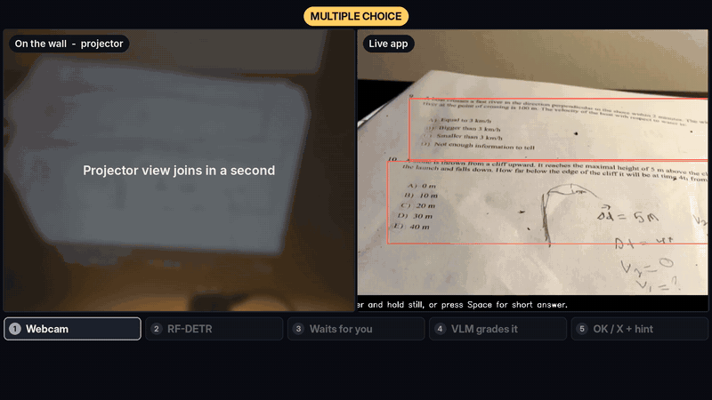
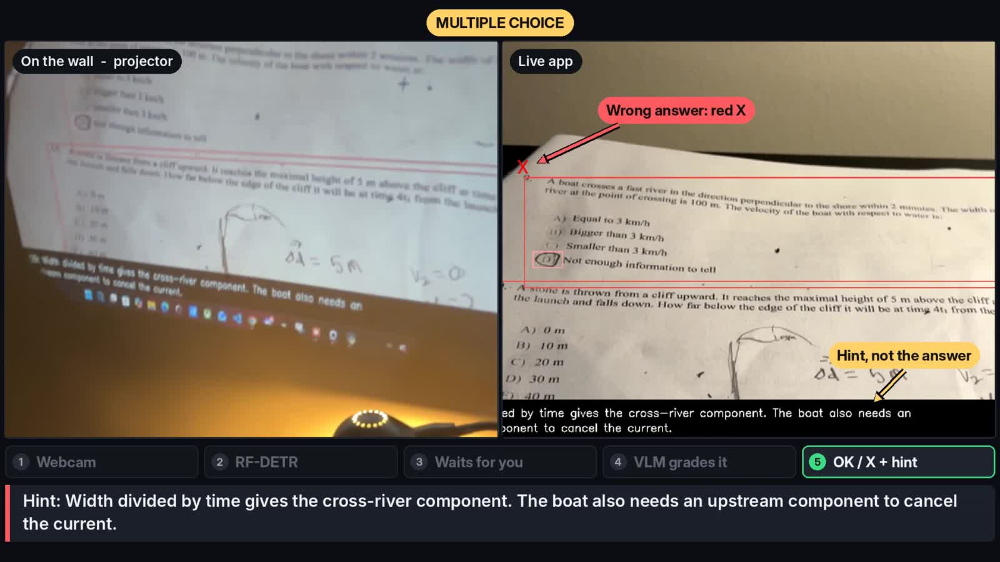
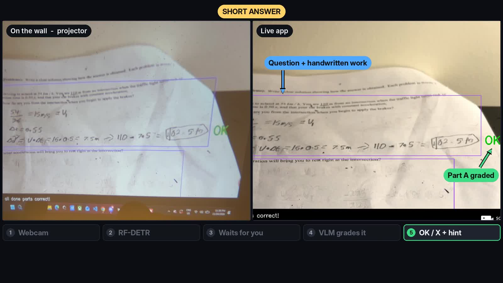

# Over the Shoulder 👀

**An AI study tutor that watches you work on real paper and won't just give you the answer.**

A webcam over your desk watches you solve exam questions by hand. A custom **RF-DETR** model trained in **Roboflow** finds each question and your answer. A **vision-language model** then grades it and puts an **OK** or a **red X** with a hint on screen and on a projector. You get a nudge toward your mistake, never the solution, so you actually learn before the exam.

<p align="center">
  
</p>

---

## What it does

| Multiple choice | Short answer |
|---|---|
| Circle an answer and hold still. It detects the question and your circle, grades it, and shows **OK** or **X + a hint**. Circle a new answer and it re-checks with a more specific hint. | Just write. When you pause, it grades every part you've **finished** (finish part A and start part B, and A gets marked on its own). Wrong parts get an **X** next to your answer and a hint aimed at the actual mistake. |
|  |  |

- ✍️ **Real paper.** No tablet, no app, no typing the question in.
- 💡 **Hints, not answers.** Each new hint gets more specific (up to 3 per question).
- ⚡ **Keeps up with you.** Grading runs in background threads, so several questions can be checked at once while you move on to the next one.
- 📄 **Follows the page.** Questions are tracked as the paper moves (phase-correlation motion tracking), so marks stay on the right question.
- 🧽 **Ignores erased work.** Faint and ghosted pencil is filtered out before grading.
- 🔦 **Projector mode.** Fullscreen output for a wall projector (press `F`).

## How it works

```
 webcam frame
     │
     ▼
 RF-DETR (Roboflow)  ── finds Question / Answer / selected_choice boxes
     │                  (supervision: NMS, box handling, drawing)
     ▼
 crop each question  ── match circles + work to their question
     │
     ▼
 wait for the student ── MC: circle still for 1.5 s · SA: pen paused + new ink
     │
     ▼
 VLM grades the crop  ── returns JSON: correct?, hint, per-part results
     │
     ▼
 OK / X + hint  ──────── drawn on the live feed and sent to the projector
```

1. **Detect:** a custom RF-DETR model (`over-the-shoulder/1`), trained in Roboflow on **369 labelled frames** from my own overhead webcam footage, finds three classes: `Question`, `Answer` (handwritten work) and `selected_choice` (the circled option). Inference runs on Roboflow's serverless API, and **supervision** handles the detections.
2. **Crop:** each question box is grown to cover its work, padded and cropped. Circles and work boxes are matched to questions by their center point.
3. **Trigger:** multiple choice is graded once the circle has been still for 1.5 s. Short answer is graded when the frame stops changing (you've paused) and enough new ink has appeared since the last grade.
4. **Grade:** the crop goes to a vision-language model with a tutor prompt. It solves the question privately, grades the answer (or each finished part) and writes a hint of 20 words or fewer that never states the answer. It returns structured JSON.
5. **Show:** OK / X marks are drawn next to the question or part, and the hint goes in the bottom bar. The window can go fullscreen on a projector.

### About the VLM

I first ran the VLM **locally**: **Qwen2.5-VL-3B** in 4-bit (bitsandbytes) on my laptop's 6 GB RTX 4050, transcribing each crop before a separate grading step (`vlm.py`, `check.py`, `test_pipeline.py`). It worked, but it was far too slow for real time. A local VLM at live speed needs a much bigger GPU. The live app (`main.py`) sends each crop straight to **GPT's vision model** (`check_image.py`), so reading and grading happen in one call.

## Project structure

| File | What it does |
|---|---|
| `main.py` | **The live app:** webcam loop, detection thread, grading workers, question tracking, triggers, drawing, projector mode |
| `crops.py` | RF-DETR inference + turning detections into one crop per question |
| `check_image.py` | VLM grading straight from the crop image (multiple choice + short answer) and the erased-pencil filter |
| `detect.py` | Simple live viewer for the detector (press `s` to save a screenshot) |
| `vlm.py` | Local Qwen2.5-VL-3B (4-bit) transcription, from the first version |
| `check.py` | Text-based grading of a Qwen transcription, from the first version |
| `test_pipeline.py` | Runs the first version (detect → Qwen → grade) on a saved photo |

## Setup

```bash
git clone https://github.com/007Aurick/Over-the-Shoulder.git
cd Over-the-Shoulder
pip install -r requirements.txt
```

Create a `.env` file (it's already in `.gitignore`, so never commit it):

```
ROBOFLOW_API_KEY=your_roboflow_private_api_key
OPENAI_API_KEY=your_openai_api_key
```

## Usage

```bash
python main.py
```

| Key | Action |
|---|---|
| `Space` | Grade the short answer now (it also auto-grades when you pause) |
| `F` | Toggle fullscreen (for the projector) |
| `B` | Show / hide detection boxes |
| `R` | Reset all marks and hints |
| `Q` | Quit |

**Projector:** plug it in over HDMI, press `Win + P` and choose **Extend**, drag the window onto the projector's screen and press `F`.

**Tips:** mount the webcam overhead, keep a desk lamp on the paper, and circle tightly around one letter.

## Tech stack

| Part | Tool |
|---|---|
| Object detection | RF-DETR, trained + hosted on Roboflow |
| Detection handling | supervision |
| Grading + hints | Vision-language model (GPT vision); Qwen2.5-VL-3B in the local prototype |
| Vision / tracking | Python, OpenCV (phase correlation, ink differencing) |
| Hardware | USB webcam, HDMI projector |

## What's next

- **Project directly onto the paper:** a camera-to-projector homography so the X and hint land right next to the question on the page, not on a wall.
- Retrain the detector with more short-answer and webcam footage.
- A faster local VLM path for machines with bigger GPUs.

---

Built by **Aurick Anwar** · [GitHub](https://github.com/007Aurick)
